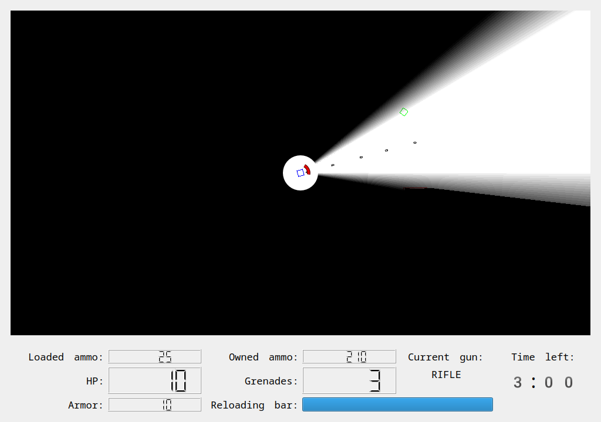

# Qt simple shooter game

A top-down 2D shooter written in C++17 with Qt Widgets. You fight one AI bot on a city map, in rounds of 1, 3 or 5 minutes; whoever has more kills when the time runs out wins.



## Features

- **Limited view:** you only see a 30° cone in the direction you aim (fading out over another 10° on each side) and a small circle around you. Buildings cast shadows, so anyone behind a wall stays hidden.
- **Shot marker:** a red arc around your hero points to where an enemy just fired from (or where its grenade went off), hit or miss, so you can react to shots from the dark. Closer shots give a thicker arc.
- **Weapons:** pistol, automatic rifle and shotgun, each with its own magazine and reserve, plus grenades. Hold Q longer to throw further. Grenades fly in an arc, bounce off walls, chests and heroes, and explode after 5 seconds.
- **Chests:** one appears every 30 seconds, with ammo, health, armour or grenades inside.
- **The bot** sees exactly what you would in its place. It fights you, hides while reloading, searches the spot where it last saw you, throws grenades around corners and dodges the grenades it sees.
- **Rounds, pause and menu:** Esc pauses the game. Going back to the menu keeps the game frozen, so you can continue it later. The round length is set in Options.

## Controls

| Key | Action |
|---|---|
| W A S D | Move |
| Mouse | Aim |
| Left mouse button | Shoot (hold for automatic fire) |
| R | Reload |
| Q | Throw a grenade (hold to throw further) |
| E | Open a chest next to you |
| 1 / 2 / 3 | Pistol / rifle / shotgun |
| X (hold) | Leaderboard |
| Esc | Pause |

## Building

You need Qt 5.15 or Qt 6 (the Widgets module), qmake and a C++17 compiler. On Debian or Ubuntu, Qt 5 comes with `sudo apt install qtbase5-dev qt5-qmake g++ make`.

Build outside the source folder and run:

```bash
mkdir -p build && cd build
qmake ../shooter.pro
make -j
./shooter
```

To use Qt 6, run the `qmake` from your Qt 6 installation instead, for example `~/Qt/6.11.2/gcc_64/bin/qmake ../shooter.pro`. You can also open `shooter.pro` in Qt Creator.

## Tests

The `tests/` folder has a Qt Test suite covering pathfinding, weapons, the field of view, the bot, the shot marker, pausing, the menus and rounds. It runs without a display and takes about a minute, since many tests play out in real time:

```bash
mkdir -p build/tests && cd build/tests
qmake ../../tests/tests.pro
make -j
make check
```

To also check for memory errors and leaks, build the tests with AddressSanitizer:

```bash
mkdir -p build/tests-asan && cd build/tests-asan
qmake ../../tests/tests.pro CONFIG+=debug "QMAKE_CXXFLAGS+=-fsanitize=address -fno-omit-frame-pointer" "QMAKE_LFLAGS+=-fsanitize=address"
make -j
LSAN_OPTIONS=suppressions=../../tests/lsan.supp ./tests
```

## Project layout

| Folder | Contents |
|---|---|
| `core/` | Constants, the game clock (game time that stops while paused) and saved settings |
| `ui/` | Windows, menus, the bottom bar and the overlays |
| `world/` | The map, the view, the field of view, the shot marker and the objects on the map |
| `characters/` | The player, the bot and its pathfinding, kill/death stats |
| `weapons/` | Guns, bullets and grenades |
| `tests/` | The test suite |

`shooter.pro` builds the game; the list of game sources lives in `game.pri`, which the tests share.
